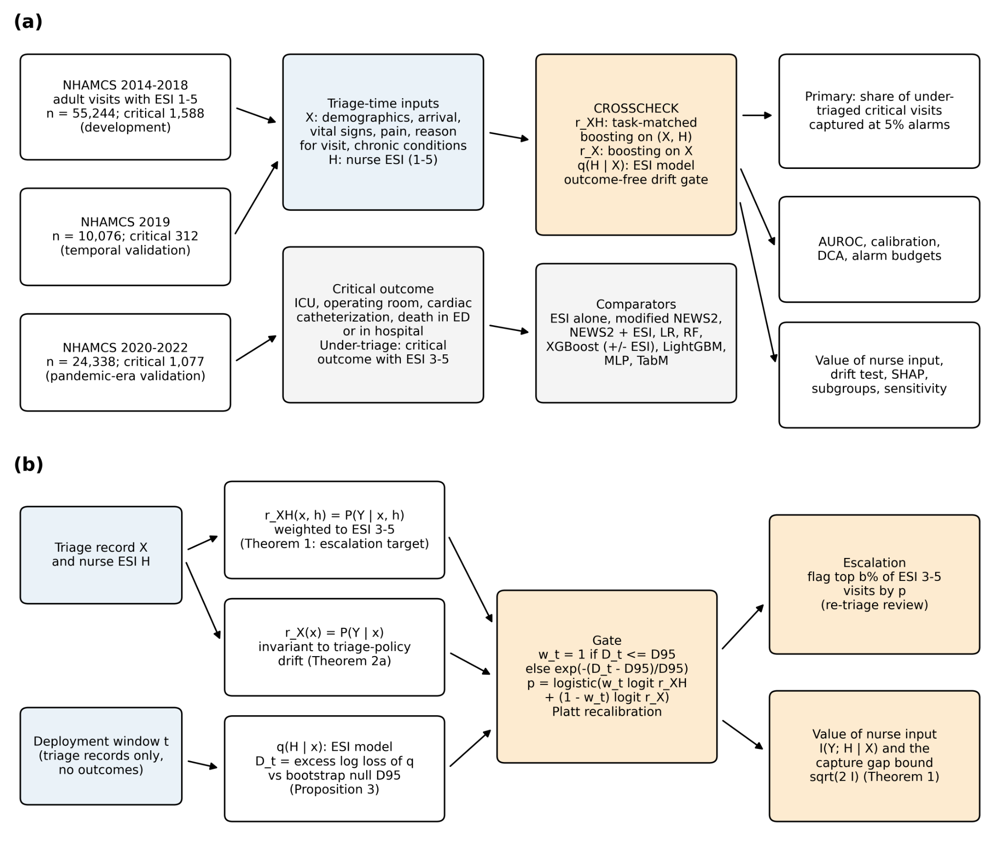
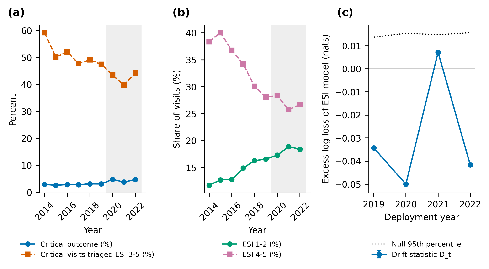
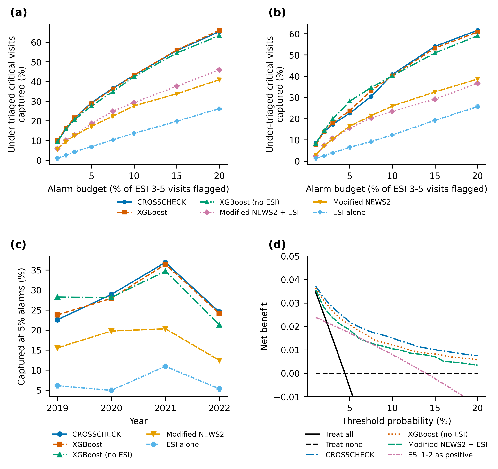
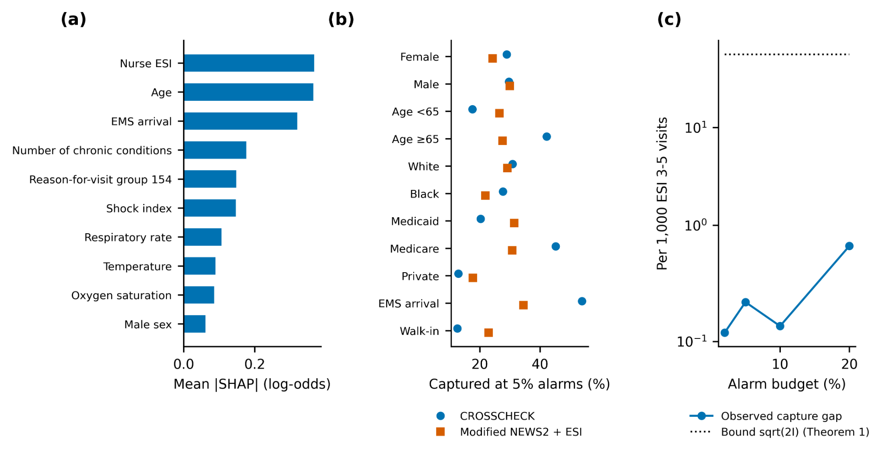

# CROSSCHECK

### Artificial intelligence detection of undertriage in United States emergency departments across the pandemic era

<p align="center">
  
</p>

<p align="center"><em>Study design and CROSSCHECK framework.</em></p>

## Overview

Emergency Severity Index (ESI) triage can assign critically ill patients to levels 3–5. CROSSCHECK is an escalation framework that uses information available at triage to identify these undertriaged visits under a fixed review capacity. It combines a nurse-informed risk model with a recorded-data-only model and monitors the relationship between recorded data and nurse ESI without requiring outcome labels at deployment.

The study uses 89,658 adult emergency department visits from the US National Hospital Ambulatory Medical Care Survey (NHAMCS), 2014–2022. The analysis plan was frozen on 22 September 2026 before model fitting.

## Clinical task

- **Population:** adult ED visits with ESI 1–5, excluding patients dead on arrival and visits with unknown outcomes
- **Critical outcome:** ICU, operating room, or cardiac catheterization laboratory admission; death in the ED; or in-hospital death
- **Undertriage:** a critical outcome in a visit assigned ESI 3–5
- **Primary endpoint:** proportion of undertriaged critical visits captured when the model flags the highest-risk 5% of ESI 3–5 visits
- **Intended use:** a capacity-constrained re-triage prompt, not a replacement for nurse triage

## Study design

| Cohort | Years | Visits | Critical outcomes | Undertriaged critical visits | Role |
|---|---:|---:|---:|---:|---|
| Development | 2014–2018 | 55,244 | 1,588 | 827 | Model fitting and tuning |
| Temporal validation | 2019 | 10,076 | 312 | 148 | Held-out pre-pandemic evaluation |
| Pandemic-era validation | 2020–2022 | 24,338 | 1,077 | 459 | Prespecified primary evaluation |

Validation years were used once and were not used for fitting.

## CROSSCHECK framework

Let \(X\) denote recorded triage-time variables, \(H\) nurse ESI, and \(Y\) the critical outcome.

1. **Nurse-informed risk:** \(r_{XH}=P(Y=1\mid X,H)\), fitted with task-matched weighting toward ESI 3–5 visits.
2. **Recorded-data risk:** \(r_X=P(Y=1\mid X)\), which does not depend on nurse ESI.
3. **Outcome-free drift monitor:** \(q(H\mid X)\) measures the excess log loss \(D_t\) in each deployment window.
4. **Drift gate:** the gate retains the nurse-informed score when \(D_t\) is within its bootstrap null threshold and progressively shifts weight toward \(r_X\) when triage-policy drift is detected.
5. **Capacity-constrained escalation:** among ESI 3–5 visits, the highest-risk fraction is flagged according to the available alarm budget.

The theoretical analysis bounds the gain obtainable from nurse triage within ESI 3–5 by

$$
C^*(b)-C_X(b) \leq \sqrt{2I(Y;H\mid X,H\geq3)}.
$$

## Triage-time inputs

Recorded features include age, sex, arrival mode, residence, payer, vital signs, pain score, shock index, missingness indicators, 72-hour revisit, episode type, injury status, chronic conditions, and grouped reasons for visit. Nurse ESI is modeled separately. Race and ethnicity are used only for subgroup evaluation.

## Models and evaluation

Comparators include ESI ordering, a modified NEWS2-type score with and without ESI, logistic regression, random forest, XGBoost with and without ESI, LightGBM, MLP, and TabM.

- Five seeds: 42, 13, 35, 24, and 69
- Twelve random hyperparameter configurations per model
- 1,000 bootstrap resamples for 95% confidence intervals
- Paired bootstrap comparisons with Holm correction
- DeLong tests for AUROC
- Calibration, decision-curve, robustness, ablation, explanation, and subgroup analyses

## Main results

In the pandemic-era validation cohort, flagging 5% of ESI 3–5 visits produced:

| Model | Undertriaged critical visits captured | Flags per capture | Overall AUROC | AUROC within ESI 3–5 |
|---|---:|---:|---:|---:|
| ESI alone | 6.9% | 32.1 | 0.753 | 0.616 |
| Modified NEWS2 + ESI | 18.6% | 11.7 | 0.792 | 0.694 |
| XGBoost | 28.8% | 7.5 | 0.858 | 0.822 |
| LightGBM | 29.0% | 7.5 | 0.858 | 0.821 |
| **CROSSCHECK** | **29.3%** (95% CI 24.7–32.3) | **7.4** | **0.857** | **0.821** |

CROSSCHECK outperformed ESI and vital-sign comparators, while differences from machine-learning comparators were not statistically significant. Nurse ESI added only 0.0013 nats beyond recorded data within ESI 3–5. The outcome-free statistic detected no triage-policy drift from 2019 through 2022, so the gate did not down-weight the nurse-informed model.

<p align="center">
  
</p>

<p align="center"><em>Undertriage, acuity distribution, and the outcome-free drift statistic over time.</em></p>

<p align="center">
  
</p>

<p align="center"><em>Capture of undertriaged critical visits across alarm budgets and validation periods.</em></p>

## Interpretation and subgroup findings

Within ESI 3–5, nurse triage contributed little incremental information beyond the recorded triage variables. Alarm allocation was also uneven: with one global threshold, CROSSCHECK captured 42.2% of undertriaged critical visits among patients aged 65 years or older versus 17.6% among younger patients, and 53.9% among ambulance arrivals versus 12.6% among walk-in visits. These results motivate subgroup-specific monitoring and evaluation of group-aware thresholds.

<p align="center">
  
</p>

<p align="center"><em>Feature importance, subgroup capture, and the theoretical bound on the incremental value of nurse ESI.</em></p>

## Reproducibility

NHAMCS public-use files are not redistributed in this repository. Download the 2014–2022 ED files from the official source and place them in the directory expected by `01_parse.py`. Review the configured paths before execution.

```bash
bash run_all.sh
```

The pipeline performs parsing, cohort construction, model training, CROSSCHECK estimation, statistical analysis, figure generation, document assembly, and final verification.

## Code map

| File | Purpose |
|---|---|
| `01_parse.py` | Parse annual NHAMCS public-use files |
| `02_cohort.py` | Apply eligibility criteria and construct analysis cohorts |
| `10_train.py` | Tune and train comparator models |
| `11_crosscheck.py`, `11b_crosscheck2.py` | Fit CROSSCHECK components and drift gate |
| `12_design_cv.py` | Select the task-matched design in development data |
| `20_analysis.py` | Primary, secondary, bootstrap, and calibration analyses |
| `21_shap_sens.py`, `22_ablation.py` | Explanation, sensitivity, and ablation analyses |
| `40_table1.py`, `50_figures.py`, `51_supp.py` | Generate tables and figures |
| `70_verify.py` | Verify prespecified outputs and internal consistency |

## Limitations

NHAMCS is visit-level and cross-sectional, lacks free-text complaints and deterioration timestamps, and records in-hospital death only for admitted patients. The drift gate was not tested under observed triage-policy drift because it did not activate in the validation years. Results are retrospective and do not establish prospective clinical benefit.

## Data source

- [National Hospital Ambulatory Medical Care Survey](https://www.cdc.gov/nchs/ahcd/datasets_documentation_related.htm)

